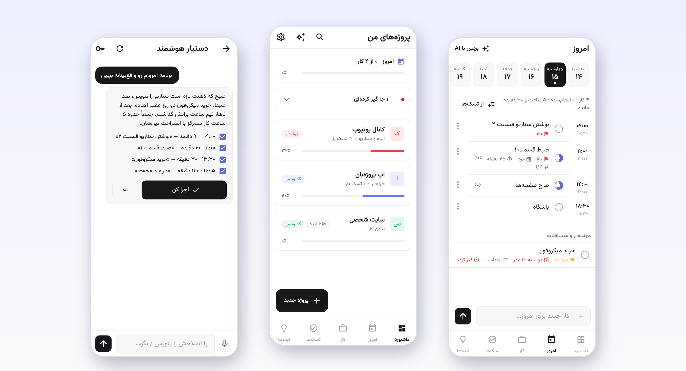
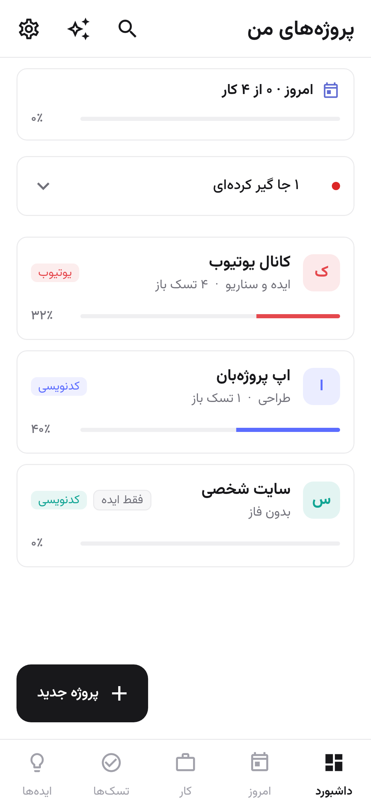
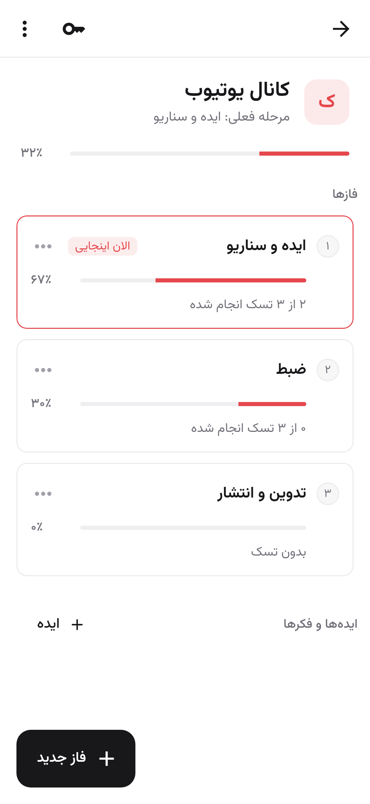
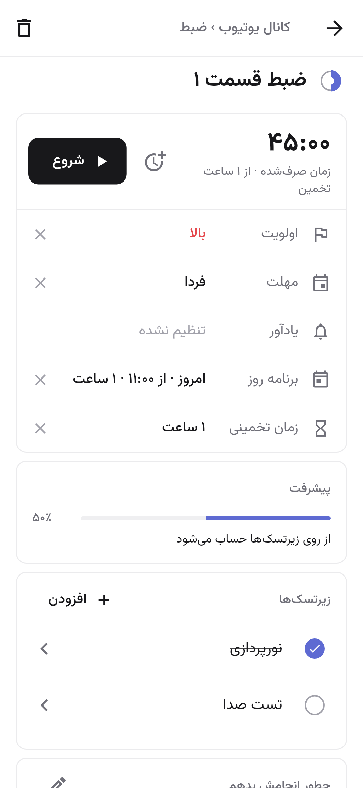
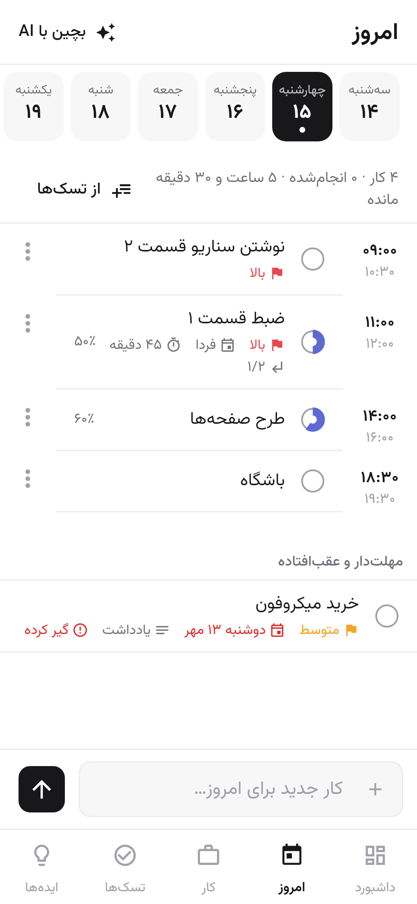
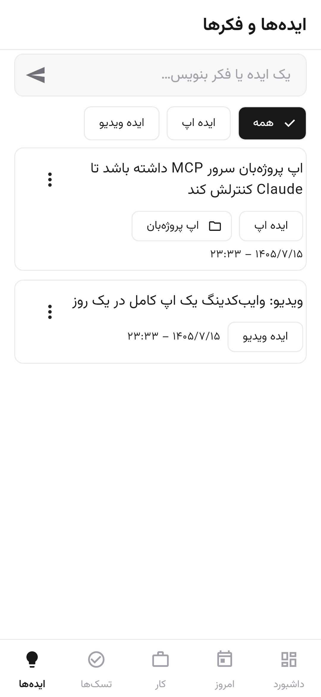
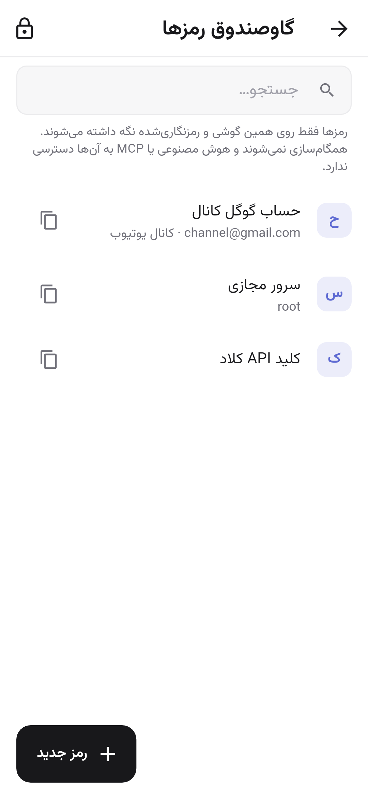
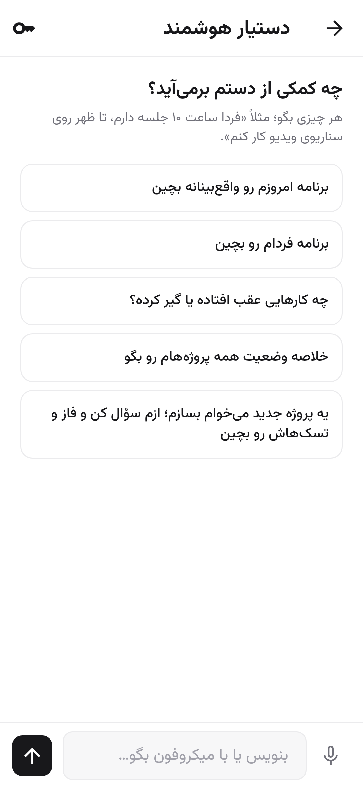
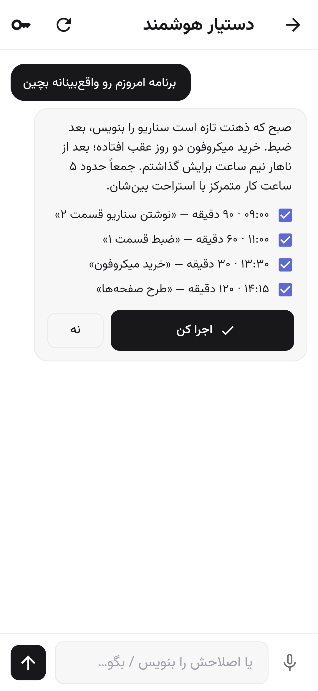
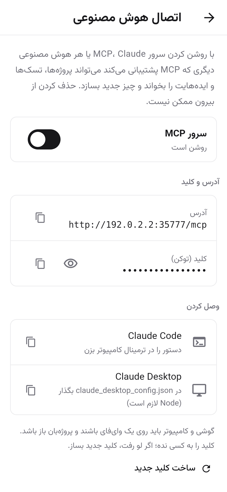

<div align="center">

# پروژه‌بان · Projeban

**همه پروژه‌ها، کارها و ایده‌هایت در یک اپ، با دستیاری که حرفت را می‌فهمد.**

یک اپ اندرویدی فارسی برای سازنده‌ها: وایب‌کدرها، یوتیوبرها، و هر کسی که هم‌زمان چند پروژه، یک شغل و یک دفتر پر از ایده دارد.

[](https://github.com/ersan0874/projeban-releases/releases/latest)

[](https://github.com/ersan0874/projeban-releases/releases)
[](https://github.com/ersan0874/projeban-releases/releases)




</div>

<div dir="rtl">

## فهرست

- [چرا پروژه‌بان؟](#چرا-پروژهبان)
- [قابلیت‌ها](#قابلیتها)
- [نصب](#نصب)
- [شروع سریع در ۵ دقیقه](#شروع-سریع-در-۵-دقیقه)
- [راهنمای کامل](#راهنمای-کامل)
- [دستیار هوشمند](#دستیار-هوشمند)
- [وصل کردن Claude و ابزارهای دیگر با MCP](#وصل-کردن-claude-و-ابزارهای-دیگر-با-mcp)
- [حریم خصوصی و امنیت](#حریم-خصوصی-و-امنیت)
- [پرسش‌های رایج](#پرسشهای-رایج)
- [نقشه راه](#نقشه-راه)
- [گزارش مشکل و پیشنهاد](#گزارش-مشکل-و-پیشنهاد)

---

## چرا پروژه‌بان؟

اگر هم‌زمان کد می‌زنی، ویدیو می‌سازی، سر کار می‌روی و هر روز چند ایده تازه به ذهنت می‌رسد، احتمالاً کارهایت بین یادداشت گوشی، چند اپ تودو و حافظه‌ات پخش شده‌اند. پروژه‌بان همه را یک جا جمع می‌کند:

- 📊 **همیشه می‌دانی کجای هر پروژه‌ای.** درصد پیشرفت و «مرحله فعلی» هر پروژه خودکار حساب می‌شود.
- 🧠 **ایده‌ها گم نمی‌شوند.** در دو ثانیه ثبتشان کن و هر وقت آماده بودی تبدیلشان کن به پروژه.
- 🗓️ **روزت واقع‌بینانه چیده می‌شود.** دستیار هوشمند به مهلت‌ها، اولویت‌ها و وقت آزادت نگاه می‌کند.
- 🤖 **هوش مصنوعی مستقیم کار می‌کند.** به Claude بگو «برای ویدیو بعدی‌ام پروژه بساز» و پروژه با فاز و تسک در اپ ساخته می‌شود.
- 🔒 **اطلاعاتت مال خودت است.** همه‌چیز روی گوشی خودت می‌ماند، بدون حساب کاربری و بدون سرور.

---

## قابلیت‌ها

<table>
<tr>
<td width="33%" valign="top">

### 📁 پروژه‌ها، تا ریزترین کار
پروژه ← فاز ← تسک ← زیرتسک. تیک بزن یا درصد دستی بده؛ درصد فاز و پروژه خودکار حساب می‌شود. مرتب‌سازی با کشیدن.

</td>
<td width="33%" valign="top">

### ⏱️ تایمر و زمان‌بندی
کرنومتر روی هر تسک با اعلان ثابت، زمان تخمینی در برابر واقعی، مهلت با تقویم شمسی، یادآور و اولویت.

</td>
<td width="33%" valign="top">

### 📅 برنامه امروز
روزت را ساعت به ساعت بچین، کارهای عقب‌افتاده را ببین، و اگر برنامه بیش از حد پر شد هشدار بگیر.

</td>
</tr>
<tr>
<td valign="top">

### ✨ دستیار هوشمند
با متن یا صدای فارسی حرف بزن. دستیار پیشنهاد می‌دهد و **هیچ کاری بدون تأیید تو انجام نمی‌شود.**

</td>
<td valign="top">

### 🔌 سرور MCP داخل گوشی
Claude Code، Claude Desktop و هر ابزار سازگار با MCP می‌تواند پروژه‌هایت را بخواند و کار بسازد.

</td>
<td valign="top">

### 🔐 گاوصندوق رمزها
رمزها و کلیدهای API هر پروژه با رمزنگاری AES-256 و قفل اثر انگشت. هرگز به هوش مصنوعی داده نمی‌شود.

</td>
</tr>
<tr>
<td valign="top">

### 💡 ایده‌ها
ثبت سریع، دسته‌بندی (ایده ویدیو، ایده اپ…)، وصل کردن به پروژه و تبدیل به پروژه.

</td>
<td valign="top">

### 💼 کار و زندگی جدا
تب «کار» برای پروژه‌های شغلی، جدا از پروژه‌های شخصی. تب «تسک‌ها» برای کارهای تکی.

</td>
<td valign="top">

### 🚧 «گیر کرده‌ام»
روی هر تسکی که گیر کرده‌ای علامت بزن و بنویس چرا. داشبورد همه گیرها را یک جا نشان می‌دهد.

</td>
</tr>
</table>

و همچنین: جستجو در همه‌چیز (حتی یادداشت‌ها)، پشتیبان‌گیری و بازگردانی، رابط کاملاً فارسی و راست‌چین، طراحی مینیمال، و کار کامل بدون اینترنت.

### نگاهی به اپ

<div align="center">

| داشبورد | داخل پروژه | صفحه تسک |
|:---:|:---:|:---:|
|  |  |  |
| **برنامه امروز** | **ایده‌ها** | **گاوصندوق رمزها** |
|  |  |  |
| **دستیار هوشمند** | **پیشنهاد و تأیید** | **اتصال MCP** |
|  |  |  |

</div>

---

## نصب

> **نیازمندی‌ها:** گوشی اندروید. برای دستیار هوشمند و MCP اینترنت یا وای‌فای لازم است؛ بقیه اپ کاملاً آفلاین کار می‌کند.

1. از گوشی به صفحه **[Releases](https://github.com/ersan0874/projeban-releases/releases/latest)** برو.
2. در بخش **Assets** فایلی که با `.apk` تمام می‌شود را دانلود کن.
3. فایل را باز کن. اگر اندروید پرسید، اجازه «نصب از منابع ناشناس» را برای مرورگر یا مدیر فایل بده.
4. نصب را بزن و پروژه‌بان را باز کن. بعد از اولین اجرا اجازه اعلان‌ها را بده تا تایمر و یادآورها کار کنند.

<details>
<summary><b>به‌روزرسانی به نسخه جدید</b></summary>

<br>

نسخه جدید را مثل بالا دانلود و نصب کن؛ روی نسخه قبلی نصب می‌شود و اطلاعاتت می‌ماند. برای اطمینان، قبلش از **تنظیمات ← گرفتن فایل پشتیبان** یک نسخه پشتیبان بگیر.

</details>

<details>
<summary><b>بررسی سلامت فایل (اختیاری)</b></summary>

<br>

کد SHA-256 هر فایل در توضیحات همان نسخه در صفحه Releases نوشته شده است. اگر کد فایل دانلودشده با آن یکی بود، فایل دست‌نخورده است:

```bash
sha256sum projeban-*.apk
```

</details>

---

## شروع سریع در ۵ دقیقه

1. **اولین پروژه:** در داشبورد «پروژه جدید» را بزن، اسم و برچسب بده (یوتیوب، کدنویسی، شخصی…).
2. **فازها:** داخل پروژه «فاز جدید» بزن، مثلاً «ایده و سناریو»، «ضبط»، «تدوین و انتشار».
3. **تسک‌ها:** داخل هر فاز تسک‌ها را اضافه کن. هر تسک را باز کنی، زیرتسک، مهلت، اولویت و تایمر دارد.
4. **امروز:** در تب «امروز» با «از تسک‌ها» کارهای امروز را بچین یا یک کار جدید بنویس.
5. **ایده:** هر وقت فکری به ذهنت رسید، در تب «ایده‌ها» بنویس و بفرست.

> 💡 **میان‌بُر:** به جای همه این‌ها، کلید API را در دستیار هوشمند وارد کن و بگو: «یه پروژه بساز برای ویدیو بعدی کانالم با فازها و تسک‌های مناسب».

---

## راهنمای کامل

<details open>
<summary><b>🏠 داشبورد</b></summary>

<br>

- هر پروژه یک کارت دارد: اسم، برچسب رنگی، فاز فعلی، تعداد تسک‌های باز و نوار پیشرفت.
- کارت **«امروز»** بالای صفحه نشان می‌دهد چند کار از برنامه امروز انجام شده.
- کارت **«جاهایی که گیر کرده‌ای»** همه تسک‌های گیرکرده را در یک لیست جمع می‌کند.
- ترتیب پروژه‌ها را با نگه داشتن و کشیدن کارت‌ها عوض کن.
- وضعیت هر پروژه: فعال، متوقف، تمام‌شده یا «فقط ایده».

</details>

<details>
<summary><b>📁 پروژه، فاز، تسک و زیرتسک</b></summary>

<br>

**درصد پیشرفت چطور حساب می‌شود؟**

| سطح | درصد |
|---|---|
| زیرتسک | تیک‌خورده یعنی ۱۰۰٪، یا درصد دستی برای کار نیمه‌تمام |
| تسک | میانگین زیرتسک‌ها، یا درصد دستی اگر زیرتسک ندارد |
| فاز | میانگین تسک‌ها |
| پروژه | میانگین فازها |

**مرحله فعلی** پروژه اولین فازی است که هنوز تمام نشده. می‌توانی دستی هم انتخابش کنی؛ فاز فعلی با برچسب «الان اینجایی» مشخص می‌شود.

**هر تسک این‌ها را دارد:**
- ⏱️ **تایمر:** «شروع» را بزن؛ تایمر حتی با بستن اپ ادامه می‌دهد و در اعلان‌ها دیده می‌شود. در هر لحظه یک تایمر فعال است.
- ⌛ **زمان تخمینی:** کنار زمان صرف‌شده نشان داده می‌شود تا کم‌کم تخمین‌هایت دقیق‌تر شود.
- 📆 **مهلت** با تقویم شمسی و 🔔 **یادآور** با اعلان.
- 🚩 **اولویت:** بالا، متوسط، پایین.
- 📝 **«چطور انجامش بدهم»** قبل از کار و **«چطور انجامش دادم»** بعد از کار؛ یک دفترچه فنی برای دفعه بعد.
- 🚧 **«گیر کرده‌ام»** با یک خط توضیح.

</details>

<details>
<summary><b>📅 تب امروز</b></summary>

<br>

- بالای صفحه روز را انتخاب کن (امروز یا روزهای بعد).
- **«از تسک‌ها»:** تسک‌های پروژه‌ها، کار و تسک‌های تکی را به برنامه روز اضافه کن و ساعتش را تعیین کن.
- **«کار جدید برای امروز»:** یک کار سریع بنویس و اضافه کن.
- بخش **«مهلت‌دار و عقب‌افتاده»** کارهایی را نشان می‌دهد که مهلتشان رسیده یا گذشته.
- اگر برنامه روز بیش از حد پر شود، هشدار می‌گیری.
- **«بچین با AI»:** دستیار، برنامه‌ای واقع‌بینانه با استراحت بین کارها پیشنهاد می‌دهد.

</details>

<details>
<summary><b>💼 تب کار و ✅ تب تسک‌ها</b></summary>

<br>

- **کار:** پروژه‌های شغلی با همان امکانات پروژه‌های شخصی، ولی جدا تا قاطی نشوند.
- **تسک‌ها:** کارهای تکی که به پروژه‌ای ربط ندارند (خرید، تماس، …). هر وقت خواستی، یک تسک را به یک پروژه منتقل کن.

</details>

<details>
<summary><b>💡 تب ایده‌ها</b></summary>

<br>

- ایده را بنویس و بفرست؛ همین.
- دسته‌بندی با چیپ‌ها: ایده ویدیو، ایده اپ و …
- از منوی هر ایده: وصل کردن به یک پروژه، ویرایش، یا **تبدیل به پروژه**.

</details>

<details>
<summary><b>🔐 گاوصندوق رمزها</b></summary>

<br>

- از **تنظیمات ← گاوصندوق رمزها**، یا از آیکون کلید داخل هر پروژه باز می‌شود.
- برای هر رمز: عنوان، نام کاربری، رمز یا کلید، و پروژه مرتبط (یا عمومی).
- باز شدن با اثر انگشت یا قفل گوشی؛ بعد از ۳ دقیقه استفاده‌نکردن خودکار قفل می‌شود.
- کپی با یک لمس؛ کلیپ‌بورد بعد از ۴۵ ثانیه پاک می‌شود.
- ساخت رمز قوی تصادفی هنگام افزودن.

</details>

<details>
<summary><b>🔎 جستجو، پشتیبان‌گیری و بازگردانی</b></summary>

<br>

- **جستجو** (آیکون ذره‌بین در داشبورد): در پروژه‌ها، تسک‌ها، ایده‌ها و حتی یادداشت‌ها.
- **تنظیمات ← گرفتن فایل پشتیبان:** یک فایل JSON از همه پروژه‌ها، تسک‌ها و ایده‌ها (بدون رمزهای گاوصندوق) که می‌توانی ذخیره یا برای خودت بفرستی.
- **تنظیمات ← بازگردانی از فایل پشتیبان:** اطلاعات فایل را برمی‌گرداند؛ مواردی که روی گوشی جدیدترند دست نمی‌خورند.

</details>

---

## دستیار هوشمند

دستیار پروژه‌بان با **Claude** کار می‌کند و پروژه‌ها، تسک‌ها و برنامه‌ات را خودش می‌خواند.

**راه‌اندازی:**
1. از [console.anthropic.com](https://console.anthropic.com) یک کلید API بساز (با `sk-ant-` شروع می‌شود).
2. در اپ آیکون ✨ را بزن، روی آیکون کلید بزن و کلید را وارد کن. کلید فقط روی گوشی و رمزنگاری‌شده ذخیره می‌شود.

**همیشه این‌طور کار می‌کند:** تو می‌گویی ← دستیار پیشنهاد می‌دهد ← تو اصلاح یا تأیید می‌کنی ← اجرا می‌شود.

هر تغییر اول به صورت یک **چک‌لیست** نشان داده می‌شود. می‌توانی تیک بعضی موارد را برداری، اصلاح را بنویسی یا بگویی، و فقط بعد از «اجرا کن» چیزی تغییر می‌کند.

**نمونه درخواست‌ها:**

```text
برنامه امروزم رو واقع‌بینانه بچین، ساعت ۶ عصر باشگاه دارم
یه پروژه بساز برای ویدیو «ساخت اپ در یک روز» با فاز و تسک
تسک نوشتن سناریو رو ۷۰ درصد کن
یه ایده ثبت کن: ویدیو از پشت صحنه ساخت اپ
کدوم پروژه‌هام عقب افتادن؟
```

> 🎙️ با دکمه میکروفون می‌توانی فارسی حرف بزنی؛ تبدیل گفتار به متن با سرویس خود گوشی انجام می‌شود.
>
> 💳 هزینه استفاده از API مستقیم از حساب Anthropic خودت کم می‌شود و معمولاً برای استفاده شخصی ناچیز است.

---

## وصل کردن Claude و ابزارهای دیگر با MCP

پروژه‌بان یک **سرور MCP داخل گوشی** دارد. یعنی Claude Code، Claude Desktop، Cursor یا هر ابزاری که از [Model Context Protocol](https://modelcontextprotocol.io) پشتیبانی می‌کند، می‌تواند مستقیم با اپ کار کند. مثلاً در Claude Code روی لپ‌تاپ بنویسی «پروژه‌هام رو ببین و برای فاز بعدی تسک بساز» و چند ثانیه بعد تسک‌ها در گوشی‌ات باشند.

**راه‌اندازی:**
1. در اپ: **تنظیمات ← اتصال مستقیم MCP** و سرور را روشن کن.
2. اپ یک **آدرس** (مثل `http://192.168.1.20:35777/mcp`) و یک **کلید (توکن)** نشان می‌دهد.
3. گوشی و کامپیوتر باید روی **یک وای‌فای** باشند و پروژه‌بان باز باشد.

<details open>
<summary><b>Claude Code</b></summary>

<br>

دستور آماده را از همان صفحه کپی کن، یا خودت بنویس:

```bash
claude mcp add --transport http projeban http://<آدرس-گوشی>:35777/mcp \
  --header "Authorization: Bearer <توکن>"
```

</details>

<details>
<summary><b>Claude Desktop</b></summary>

<br>

متن آماده را از همان صفحه کپی کن و در فایل `claude_desktop_config.json` بگذار. Node.js باید روی کامپیوتر نصب باشد:

```json
{
  "mcpServers": {
    "projeban": {
      "command": "npx",
      "args": [
        "mcp-remote",
        "http://<آدرس-گوشی>:35777/mcp",
        "--header",
        "Authorization: Bearer <توکن>"
      ]
    }
  }
}
```

</details>

<details>
<summary><b>ابزارهای دیگر (Cursor و …)</b></summary>

<br>

هر کلاینتی که MCP روی HTTP را پشتیبانی می‌کند: آدرس بالا را بده و هدر `Authorization: Bearer <توکن>` را اضافه کن.

</details>

**هوش مصنوعی از طریق MCP چه کارهایی می‌تواند بکند:**

| دسته | ابزارها |
|---|---|
| خواندن | `list_projects` · `get_project` · `list_tasks` · `list_ideas` · `get_day` |
| ساختن | `create_project` · `add_phase` · `add_task` · `add_idea` |
| تغییر | `update_project` · `update_task` · `schedule_task` · `unschedule_task` |

> 🛡️ **حذف کردن از بیرون ممکن نیست.** گاوصندوق رمزها هم هیچ‌وقت از طریق MCP در دسترس نیست. اگر توکن لو رفت، در همان صفحه «ساخت کلید جدید» را بزن تا کلید قبلی باطل شود.

---

## حریم خصوصی و امنیت

| | |
|---|---|
| 📱 **محل ذخیره** | همه اطلاعات روی گوشی خودت. بدون حساب کاربری، بدون سرور، بدون آنالیتیکس و تبلیغ. |
| 🔐 **گاوصندوق** | رمزنگاری AES-256-GCM با کلید نگه‌داری‌شده در Android Keystore و قفل بیومتریک. هرگز همگام، پشتیبان‌گیری یا به هوش مصنوعی فرستاده نمی‌شود. |
| ✨ **دستیار هوشمند** | فقط وقتی از آن استفاده کنی، درخواستت همراه با اطلاعات لازم پروژه‌ها مستقیم از گوشی به API شرکت Anthropic فرستاده می‌شود. |
| 🔌 **MCP** | خاموش است تا خودت روشنش کنی؛ فقط در شبکه محلی و فقط با توکن کار می‌کند. |

**دسترسی‌هایی که اپ می‌خواهد و چرا:**

| دسترسی | برای |
|---|---|
| اینترنت | دستیار هوشمند و سرور MCP |
| اعلان‌ها و هشدار دقیق | تایمر در حال اجرا و یادآورها |
| اجرا پس از روشن شدن گوشی | زنده ماندن یادآورها بعد از ری‌استارت |
| اثر انگشت | باز کردن گاوصندوق |
| میکروفون | حرف زدن با دستیار (فقط وقتی دکمه میکروفون را بزنی) |

---

## پرسش‌های رایج

<details>
<summary><b>برای استفاده از اپ باید پول بدهم یا ثبت‌نام کنم؟</b></summary>

<br>

نه. اپ رایگان است و حساب کاربری نمی‌خواهد. فقط اگر دستیار هوشمند داخل اپ را بخواهی، کلید API خودت از Anthropic لازم است. اتصال از طریق MCP به Claude Code یا Claude Desktop کلید جدا نمی‌خواهد.

</details>

<details>
<summary><b>اندروید می‌گوید «برنامه ناشناس» یا Play Protect هشدار می‌دهد.</b></summary>

<br>

چون اپ از گوگل‌پلی نصب نمی‌شود، این هشدار طبیعی است. «جزئیات بیشتر ← نصب در هر صورت» را بزن. اگر خواستی، قبلش کد SHA-256 فایل را با کد صفحه Releases مقایسه کن.

</details>

<details>
<summary><b>Claude Code یا Claude Desktop به گوشی وصل نمی‌شود.</b></summary>

<br>

- گوشی و کامپیوتر روی یک وای‌فای باشند (بعضی وای‌فای‌های عمومی یا مهمان، دستگاه‌ها را از هم جدا می‌کنند).
- پروژه‌بان باز باشد و سرور MCP روشن.
- آدرس IP گوشی ممکن است بعد از قطع و وصل وای‌فای عوض شود؛ آدرس را دوباره از اپ کپی کن.
- اگر کلید جدید ساخته‌ای، دستور یا تنظیمات را با کلید جدید به‌روز کن.

</details>

<details>
<summary><b>می‌توانم از claude.ai یا اپ موبایل Claude هم وصل شوم؟</b></summary>

<br>

اتصال مستقیم فقط در شبکه محلی کار می‌کند و claude.ai از اینترنت به گوشی‌ات دسترسی ندارد. گزینه «سرور ابری» در تنظیمات برای همین است، ولی در این نسخه بتا هنوز برای عموم ارائه نشده و راهنمایش در نسخه‌های بعد منتشر می‌شود.

</details>

<details>
<summary><b>اگر گوشی را عوض کنم اطلاعاتم چه می‌شود؟</b></summary>

<br>

از **تنظیمات ← گرفتن فایل پشتیبان** یک فایل بگیر و در گوشی جدید با **بازگردانی از فایل پشتیبان** برگردان. رمزهای گاوصندوق عمداً در پشتیبان نیستند و باید دستی منتقل شوند.

</details>

<details>
<summary><b>نسخه آیفون هم دارد؟</b></summary>

<br>

فعلاً فقط اندروید. اپ با Flutter ساخته شده و نسخه‌های دیگر در نقشه راه هست.

</details>

---

## نقشه راه

- [x] پروژه، فاز، تسک و زیرتسک با محاسبه خودکار پیشرفت
- [x] تایمر، مهلت، یادآور، اولویت و «گیر کرده‌ام»
- [x] تب امروز و برنامه‌ریزی روزانه
- [x] گاوصندوق رمزها با اثر انگشت
- [x] دستیار هوشمند با متن و صدا
- [x] سرور MCP داخل گوشی
- [x] پشتیبان‌گیری و بازگردانی
- [ ] همگام‌سازی ابری برای همه
- [ ] ویجت صفحه اصلی (کارهای امروز و ثبت سریع ایده)
- [ ] گزارش هفتگی و آمار زمان
- [ ] حالت تیره

---

## گزارش مشکل و پیشنهاد

این اولین نسخه عمومی پروژه‌بان است و بازخوردت خیلی کمک می‌کند.

- 🐞 **مشکل دیدی؟** [یک گزارش باگ ثبت کن](https://github.com/ersan0874/projeban-releases/issues/new?template=bug_report.yml)
- 💡 **ایده‌ای داری؟** [پیشنهادت را بنویس](https://github.com/ersan0874/projeban-releases/issues/new?template=feature_request.yml)
- ⭐ اگر پروژه‌بان به کارت آمد، به این صفحه ستاره بده تا بقیه هم پیدایش کنند.

---

<div align="center">

ساخته‌شده با ❤️ و وایب‌کدینگ، توسط **[تورج محسنی](https://github.com/ersan0874)**

<sub>© ۲۰۲۶ تورج محسنی. همه حقوق محفوظ است. این مخزن فقط فایل نصبی و راهنما را منتشر می‌کند. Claude نشان تجاری Anthropic است و پروژه‌بان محصول رسمی Anthropic نیست.</sub>

</div>

</div>
